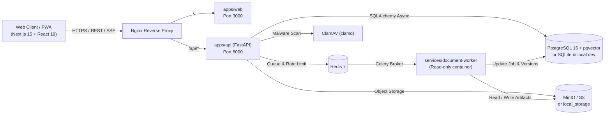

<div align="center">

# DocuMind AI

**Privacy-first AI Document Workspace & PDF Toolkit (English + தமிழ்)**

Built for students, researchers, and professionals who need exact-KB compression, exam-ready photo/signature resizing, camera-to-PDF scanning, immutable document versioning, and verifiable privacy controls.

[](https://github.com/nanthishvaran17/DocuMind-AI/actions/workflows/ci.yml)
[](LICENSE)
[](apps/api/requirements.txt)
[](apps/web/package.json)
[](apps/api/pyproject.toml)

</div>

---

## Table of Contents

- [Overview](#overview)
- [Key Features](#key-features)
- [Architecture](#architecture)
- [Monorepo Structure](#monorepo-structure)
- [Tech Stack](#tech-stack)
- [Quick Start](#quick-start)
  - [Option 1: Docker Compose (Full Stack)](#option-1-docker-compose-full-stack)
  - [Option 2: Local Development (Without Docker)](#option-2-local-development-without-docker)
- [Environment Variables](#environment-variables)
- [API Overview](#api-overview)
- [Testing, Linting & CI](#testing-linting--ci)
- [Security & Licensing](#security--licensing)
- [Roadmap](#roadmap)

---

## Overview

**DocuMind AI** combines a full-featured document workspace with deterministic PDF and image utilities in a security-hardened monorepo:

- **Non-destructive by design:** Every upload starts as immutable `v1`. Operations like compress, merge, rotate, watermark, page numbering, or unlock create new versions (`v2`, `v3`, ...) with full SHA-256 checksums and audit logs.
- **No-signup Guest Mode:** Try core PDF and image tools immediately in an ephemeral guest session. Guest files automatically expire after 60 minutes (or can be purged immediately).
- **Real metrics, never faked:** Compression reports honest before/after sizes and warns clearly if a strict target (e.g., `< 100 KB`) requires splitting pages.
- **Bilingual UI:** First-class support for **English** and **Tamil (தமிழ்)** with `Noto Sans Tamil` typography and instant switching.

---

## Key Features

### Document Workspace & Viewer
- **Chunked & Standard Uploads:** Multi-part chunked upload flow (`/upload/init`, `/upload/{id}/chunk`, `/upload/{id}/complete`) with magic-byte validation and duplicate SHA-256 detection.
- **Folder Organization & Trash:** Nested folders, favorites, search, soft-delete to Trash, restore, and permanent deletion.
- **Interactive PDF Workspace:** Resizable split-pane PDF.js viewer with page thumbnails, page metadata, and version history inspection.
- **Command Palette (`Cmd/Ctrl + K`):** Fast keyboard-first navigation via `cmdk`.
- **PWA Ready:** Installable Progressive Web App with offline-capable shell (`manifest.json` + service worker).

### PDF Toolkit (`apps/api` + `services/document-worker`)
- **Exact-KB Compression:** Presets for `Under 100 KB`, `Under 200 KB`, `Under 1 MB`, and `Under 2 MB` tailored for scholarship, university, and government portals.
- **Merge & Split:** Combine multiple PDFs with custom page-range selections (`1-3, 5`), or split by page ranges / every *N* pages.
- **Page Operations:** Rotate (`90°`, `180°`, `270°`), reorder, extract, and delete pages.
- **Annotations & Security:** Diagonal text watermarks (configurable text, opacity, angle, font size), customizable page numbering (`Page {n} of {total}`), AES-256 PDF password protection, and strict password-verified unlock.

### Student & Mobile Utilities
- **Passport, Photo & Signature Resizer:** One-click dimension, DPI, and KB presets for:
  - Passport Photo (`413×531 px`, 300 DPI, ≤ 100 KB)
  - Signature Box (`413×177 px`, 300 DPI, ≤ 50 KB)
  - GATE / JEE (`480×640 px`, 200 DPI, ≤ 200 KB)
  - UPSC / TNPSC (`350×350 px`, 200 DPI, ≤ 300 KB)
  - PAN Card (`213×213 px`, 300 DPI, ≤ 50 KB)
  - Optional background enhancement cleanup.
- **Camera Scan to PDF:** Upload 1–30 gallery/camera photos (`PNG`/`JPG`) and enhance contrast into a multi-page PDF.

### Approval-Gated Command Bar
- **Natural-Language Intent Planner (`/api/v1/ai/agent/command`):** Translates instructions like `"compress to 200 kb"`, `"rotate 90"`, `"remove pages 2-3"`, `"add page numbers"`, or `"watermark CONFIDENTIAL"` into an explicit step-by-step plan requiring user approval (`/runs/{run_id}/approve`) before dispatching jobs.

### Security, Privacy & Observability
- **Authentication & Session Hardening:** Argon2id password hashing, short-lived JWT access tokens, rotating refresh cookies, CSRF protection (`X-CSRF-Token`), and optional Google OAuth.
- **Upload Defense-in-Depth:** Extension allowlist, magic-byte inspection, PDF JavaScript action stripping, and ClamAV (`clamd`) malware scanning integration.
- **Strict Tenant Isolation:** Every document, folder, job, and agent run enforces strict ownership (`user_id` or `guest_session_id`) and RBAC.
- **Telemetry & Error Contracts:** RFC 7807 `ProblemDetails` JSON responses with `X-Request-ID` tracing, structured JSON logs, and Prometheus metrics (`/api/v1/metrics`).

---

## Architecture



---

## Monorepo Structure

```text
DocuMind AI/
├── apps/
│   ├── api/                        # FastAPI control plane, auth, RBAC, Alembic migrations
│   │   ├── alembic/                # Database schema migrations
│   │   └── app/
│   │       ├── api/v1/             # Versioned REST & SSE routers
│   │       ├── core/               # Settings, Argon2id/JWT security, rate limiting, logging
│   │       ├── db/                 # SQLAlchemy 2 async models & session management
│   │       ├── schemas/            # Pydantic v2 request/response contracts
│   │       └── services/           # Storage (S3/local), ClamAV, validation, retention, audit
│   └── web/                        # Next.js 15 App Router frontend (English + Tamil)
│       ├── messages/               # i18n dictionaries (en.json, ta.json)
│       ├── public/                 # PWA manifest, icons, service worker
│       └── src/                    # Pages, PDF.js viewer, command palette, Zustand stores
├── services/
│   └── document-worker/            # Isolated Celery worker + pdf_engine.py (AGPL boundary)
├── packages/
│   ├── shared/                     # Shared formatters, upload allowlists, photo & compress presets
│   ├── types/                      # Shared TypeScript API & domain contracts
│   └── ui/                         # Design tokens and shared UI primitives
├── infrastructure/
│   ├── deployment/                 # Nginx reverse proxy configuration
│   └── docker/                     # Dockerfiles for api, web, and document-worker
├── docs/
│   └── decisions/                  # Architecture Decision Records (ADR-001)
├── tests/
│   ├── fixtures/                   # Sample PDFs and images for automated testing
│   ├── unit/                       # File validation, AV scanner, and PDF engine unit tests
│   └── integration/                # End-to-end API integration tests
├── .github/workflows/ci.yml        # GitHub Actions (Ruff, Mypy, Pytest >=80% cov, pnpm lint/typecheck/build)
├── docker-compose.yml              # Full local stack (Postgres, Redis, MinIO, ClamAV, API, Worker, Web)
├── docker-compose.prod.yml         # Production Nginx overlay
├── Makefile                        # Developer task shortcuts
└── .env.example                    # Documented environment template
```

---

## Tech Stack

| Layer | Technologies |
| :--- | :--- |
| **Frontend** | Next.js 15 (App Router), React 19, TypeScript 5.7, Tailwind CSS v4, Framer Motion, Zustand, TanStack Query, `pdfjs-dist`, `cmdk`, `next-intl`, `next-themes`, `react-resizable-panels` |
| **Backend API** | Python 3.12, FastAPI, Pydantic v2, SQLAlchemy 2 (Async), Alembic, Argon2id (`argon2-cffi`), PyJWT, Prometheus Client |
| **Document Worker** | Celery 5, `pikepdf` (MPL-2.0), `pypdf` (BSD-3-Clause), `ReportLab` (BSD), `Pillow` (HPND), optional isolated `PyMuPDF` |
| **Data & Infra** | PostgreSQL 16 (`pgvector`), Redis 7, MinIO / S3, ClamAV, Nginx, Docker Compose, Turborepo + `pnpm` |

---

## Quick Start

### Option 1: Docker Compose (Full Stack)

Starts PostgreSQL 16 (`pgvector`), Redis, MinIO, ClamAV, FastAPI API, isolated Celery Document Worker, and Next.js Web UI:

```bash
cp .env.example .env
docker compose up --build
```

Once running:
- **Web App:** `http://localhost:3000`
- **API Docs (Swagger):** `http://localhost:8000/api/v1/docs`
- **MinIO Console:** `http://localhost:9001` (`minioadmin` / `minioadmin`)

> **Tip:** You can also run `make dev` if `make` is installed.

---

### Option 2: Local Development (Without Docker)

The `.env.example` defaults support zero-dependency local development using **SQLite** (`sqlite+aiosqlite`), **local filesystem storage** (`./local_storage`), and an **in-process task runner** (`TASK_RUNNER=inline`).

#### 1. Configure Environment
```bash
cp .env.example .env
```

#### 2. Start the Backend (`apps/api`)

**Windows (PowerShell):**
```powershell
python -m venv .venv
.\.venv\Scripts\python -m pip install -r apps/api/requirements.txt
cd apps/api
..\..\.venv\Scripts\python -m uvicorn app.main:app --reload --port 8000
```

**macOS / Linux:**
```bash
python3 -m venv .venv
.venv/bin/python -m pip install -r apps/api/requirements.txt
cd apps/api
../../.venv/bin/python -m uvicorn app.main:app --reload --port 8000
```

#### 3. Start the Frontend (`apps/web`)
```bash
pnpm install
pnpm --filter @documind/web dev
```

Open `http://localhost:3000` in your browser.

---

## Environment Variables

See [`.env.example`](.env.example) for the full reference. Key variables include:

| Variable | Default (Local Dev) | Description |
| :--- | :--- | :--- |
| `ENVIRONMENT` | `development` | `development` or `production` (enables HSTS & strict CORS) |
| `JWT_SECRET_KEY` | — | Random secret key for signing JWTs (replace in production) |
| `CSRF_SECRET_KEY` | — | Secret for CSRF token validation |
| `DATABASE_URL` | `sqlite+aiosqlite:///./documind_dev.db` | PostgreSQL (`postgresql+asyncpg://...`) or local SQLite |
| `TASK_RUNNER` | `inline` | `celery` (Redis worker) or `inline` (in-process dev runner) |
| `STORAGE_BACKEND` | `local` | `s3` (MinIO / AWS S3) or `local` (`./local_storage`) |
| `CLAMAV_MODE` | `disabled_dev` | `clamd` (active ClamAV daemon) or `disabled_dev` |
| `MAX_UPLOAD_SIZE_MB` | `50` | Maximum allowed file upload size in MB |
| `PDF_ENGINE_ALLOW_PYMUPDF` | `false` | Controls optional PyMuPDF engine inside `document-worker` |

---

## API Overview

All endpoints are served under `/api/v1` with standardized envelopes (`{ data, error, meta }`) and OpenAPI documentation at `/api/v1/docs`.

| Domain | Endpoints |
| :--- | :--- |
| **Health & Metrics** | `GET /health`, `GET /metrics` (Prometheus) |
| **Auth & Sessions** | `POST /auth/register`, `POST /auth/login`, `POST /auth/guest`, `POST /auth/refresh`, `POST /auth/logout`, `GET /auth/google` |
| **Users** | `GET /users/me`, `PATCH /users/me`, `DELETE /users/me` |
| **Documents** | `POST /documents/upload`, `POST /documents/upload/init`, `POST /documents/upload/{id}/chunk`, `POST /documents/upload/{id}/complete`, `GET /documents`, `GET /documents/{id}`, `PATCH /documents/{id}`, `DELETE /documents/{id}`, `POST /documents/{id}/restore`, `GET /documents/{id}/preview`, `GET /documents/{id}/download`, `GET /documents/{id}/pages/{page_no}/thumbnail`, `GET /documents/{id}/history` |
| **Folders & Search** | `GET/POST /folders`, `PATCH/DELETE /folders/{id}`, `GET /search` |
| **PDF & Image Tools** | `POST /tools/pdf/merge`, `POST /tools/pdf/split`, `POST /tools/pdf/pages`, `POST /tools/pdf/watermark`, `POST /tools/pdf/page-numbers`, `POST /tools/pdf/protect`, `POST /tools/pdf/unlock`, `POST /tools/compress-to-size`, `POST /tools/image-resize`, `POST /tools/scan` |
| **Jobs (SSE)** | `GET /jobs`, `GET /jobs/{id}`, `GET /jobs/{id}/events` (Server-Sent Events), `POST /jobs/{id}/cancel`, `POST /jobs/{id}/retry` |
| **Agent Command** | `POST /ai/agent/command`, `POST /ai/agent/runs/{run_id}/approve` |

---

## Testing, Linting & CI

GitHub Actions ([`.github/workflows/ci.yml`](.github/workflows/ci.yml)) enforces linting, static type checking, build verification, and a minimum **80% backend test coverage**.

### Backend Checks
```bash
# Lint & typecheck
ruff check apps/api services/document-worker tests
mypy apps/api/app services/document-worker/worker

# Unit & integration tests with coverage
cd apps/api
pytest -v --cov=app --cov=../../services/document-worker/worker --cov-fail-under=80
```

### Frontend & Monorepo Checks
```bash
pnpm lint
pnpm typecheck
pnpm build
```

---

## Security & Licensing

- **Project License:** Licensed under the **Apache License 2.0** (see [`LICENSE`](LICENSE)).
- **AGPL-3.0 Isolation ([ADR-001](docs/decisions/ADR-001-pymupdf-isolation.md)):** `PyMuPDF` is strictly prohibited from `apps/api` and isolated behind `services/document-worker/worker/pdf_engine.py`. Permissive fallbacks (`pikepdf`, `pypdf`, `ReportLab`, `Pillow`) power all core PDF operations when `PDF_ENGINE_ALLOW_PYMUPDF=false`.
- **Container Hardening:** The `document-worker` container runs with `read_only: true`, a bounded `/tmp` tmpfs, and `no-new-privileges:true`.

---

## Roadmap

- **Phase 1 (Current):** Core document workspace, guest mode, immutable versioning, PDF toolkit (merge/split/rotate/reorder/extract/delete/watermark/page-numbers/protect/unlock/exact-KB compress), photo & signature resizer, camera scan to PDF, bilingual EN/TA UI, and approval-gated command bar.
- **Upcoming Phases:** RAG semantic search over `pgvector` embeddings, document Q&A chat, Office/Markdown format conversions, and multi-step LLM workflow execution.

---

<div align="center">

Made by [Nanthish](https://github.com/nanthishvaran17)

</div>
