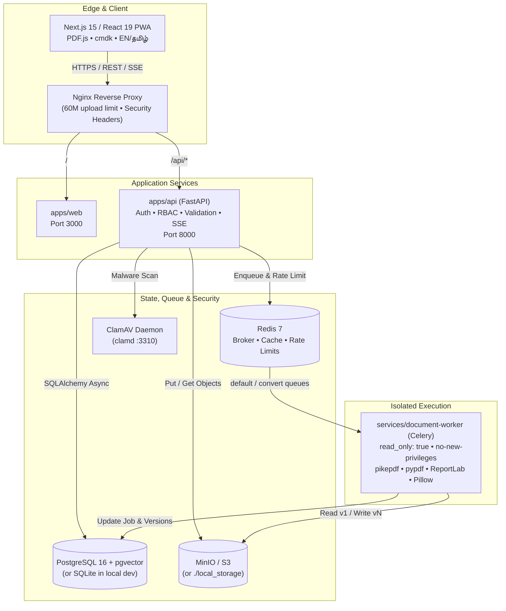
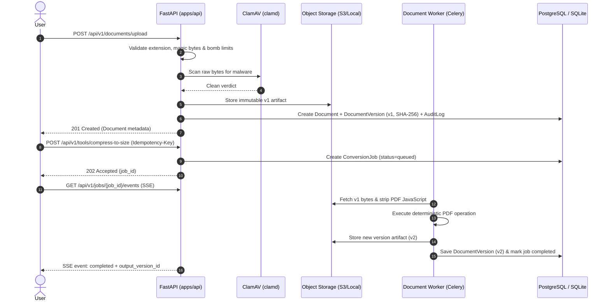
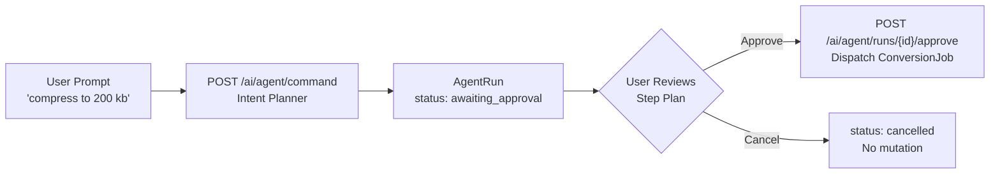

<div align="center">


<br />

[](LICENSE)
[](apps/web/package.json)
[](apps/api/pyproject.toml)
[](apps/api/requirements.txt)
[](docker-compose.yml)
[](docker-compose.yml)
[](apps/web/messages)

<br />

**A security-hardened, non-destructive AI document workspace and PDF utility suite — engineered for students, researchers, and professionals.**

[Quick Start](#-quick-start) • [Features](#-core-capabilities) • [Architecture](#-system-architecture) • [API Reference](#-api-surface) • [Security](#-security--defense-in-depth) • [Roadmap](#-roadmap)

</div>

---

## Why DocuMind AI?

Most online PDF tools silently overwrite files, enforce opaque upload limits, fake compression ratios, or offer zero visibility into retention and licensing. **DocuMind AI** is engineered from the ground up around four non-negotiable principles:

| Principle | How DocuMind AI Enforces It |
| :--- | :--- |
| **Non-Destructive Versioning** | Every upload is stored as immutable `v1` with a SHA-256 checksum. Every edit, merge, compression, or watermark produces `v2`, `v3`, … while preserving full audit history. |
| **Zero-Signup Guest Mode** | Start immediately in an isolated 60-minute guest session (`POST /api/v1/auth/guest`). Guest assets are automatically purged on expiry or on demand. |
| **Honest, Exact-KB Metrics** | Compression reports real before/after byte sizes and explicitly warns when hitting a strict target (e.g., `< 100 KB`) requires splitting pages — never silently degrades into guesswork. |
| **Defense-in-Depth & License Hygiene** | Magic-byte checks, 40 MP decompression-bomb & 150 MB ZIP-bomb guards, PDF JavaScript stripping, ClamAV scanning, and strict AGPL-3.0 isolation ([ADR-001](docs/decisions/ADR-001-pymupdf-isolation.md)). |

> [!IMPORTANT]
> **Privacy Guarantee:** Uploaded documents remain strictly scoped to your authenticated user account or ephemeral guest session (`user_id` / `guest_session_id`) and are never used to train AI models.

---

## Core Capabilities

<table>
<tr>
<td width="50%" valign="top">

### Workspace & Viewer
- **Chunked & Resumable Uploads:** Standard single-shot (`/upload`) and chunked (`/upload/init` → `/chunk` → `/complete`) flows with SHA-256 duplicate detection.
- **Interactive PDF.js Workspace:** Resizable split-pane reader (`react-resizable-panels`), per-page thumbnails, page metadata, and version history timeline.
- **Folders, Search & Safe Trash:** Nested folder hierarchy, favorites, full-text filtering, soft-delete to Trash, one-click restore, and permanent purge.
- **Bilingual EN + தமிழ் UI:** Native English and Tamil (`Noto Sans Tamil`) localization via `next-intl` with instant switching.
- **Keyboard-First & PWA:** Global `Cmd/Ctrl + K` Command Palette (`cmdk`), dark/light theming (`next-themes`), and installable PWA (`manifest.json` + `sw.js`).

</td>
<td width="50%" valign="top">

### PDF & Student Utilities
- **Exact-KB Compression:** Progressive stream & image recompression targeting `100 KB`, `200 KB`, `1 MB`, or `2 MB` portal limits.
- **Merge & Split:** Multi-document merge with per-file page ranges (`1-3, 5`), plus split by custom ranges or every *N* pages.
- **Page Manipulation:** Rotate (`90°`, `180°`, `270°`), reorder, extract, and delete pages non-destructively.
- **Annotations & Encryption:** Configurable diagonal text watermarks, template-based page numbering (`Page {n} of {total}`), AES-256 PDF protection, and password-verified unlock.
- **Exam Photo & Camera Scan:** 1-click presets for **Passport**, **Signature**, **GATE/JEE**, **UPSC/TNPSC**, and **PAN**, plus 1–30 photo **Camera Scan to PDF**.

</td>
</tr>
</table>

### Built-In Presets (Shared Type-Safe Contracts)

<details>
<summary><strong>View Exact-KB Compression & Exam Photo/Signature Presets</strong> (defined in <code>packages/shared/src/index.ts</code>)</summary>

#### PDF Compression Presets
| Preset ID | Target Size | Typical Use Case |
| :--- | :--- | :--- |
| `100kb` | Under `100 KB` | Scholarship & Exam Portals |
| `200kb` | Under `200 KB` | College Admission & Govt Forms |
| `1mb` | Under `1 MB` | Email & Assignment Upload |
| `2mb` | Under `2 MB` | Standard Portal Limit |

#### Student Photo & Signature Presets
| Preset ID | Label | Dimensions | DPI | Max Size | Format |
| :--- | :--- | :---: | :---: | :---: | :---: |
| `passport_india` | Passport Photo (3.5 × 4.5 cm) | `413 × 531 px` | `300` | `100 KB` | `JPEG` |
| `signature_standard` | Signature Box (3.5 × 1.5 cm) | `413 × 177 px` | `300` | `50 KB` | `JPEG` |
| `gate_photo` | GATE / JEE Photo | `480 × 640 px` | `200` | `200 KB` | `JPEG` |
| `upsc_photo` | UPSC / TNPSC Photo | `350 × 350 px` | `200` | `300 KB` | `JPEG` |
| `pan_photo` | PAN Card Photo | `213 × 213 px` | `300` | `50 KB` | `JPEG` |

</details>

---

## System Architecture

DocuMind AI decouples the **Web UI**, the **Control-Plane API**, and the **Read-Only Document Worker** so untrusted file parsing and AGPL-3.0 dependencies never touch the core API surface.



### Upload, Sanitization & Versioning Flow



### Approval-Gated Command Bar



---

## Monorepo Structure

```text
DocuMind AI/
├── apps/
│   ├── api/                        # FastAPI control plane, RBAC, Alembic, Prometheus metrics
│   │   ├── alembic/                # Database schema migrations
│   │   └── app/
│   │       ├── api/v1/             # health, auth, users, folders, documents, tools, jobs, search, agent
│   │       ├── core/               # config, security (Argon2id/JWT), rate_limit, structured JSON logging
│   │       ├── db/                 # SQLAlchemy 2 async models (11 tables) & session management
│   │       ├── schemas/            # Pydantic v2 envelopes & RFC 7807 ProblemDetails
│   │       └── services/           # storage (S3/local), clamav, file_validation, job_runner, retention, audit
│   └── web/                        # Next.js 15 App Router frontend (English + தமிழ்)
│       ├── messages/               # en.json & ta.json translation dictionaries
│       ├── public/                 # PWA manifest.json, icon.svg, service worker (sw.js)
│       └── src/                    # App Router pages, PDF.js viewer, CommandPalette, Zustand stores
├── services/
│   └── document-worker/            # Isolated Celery worker + pdf_engine.py (AGPL-3.0 boundary)
├── packages/
│   ├── shared/                     # Formatters, upload extension allowlists, compression & photo presets
│   ├── types/                      # Shared TypeScript API contracts & domain models
│   └── ui/                         # Design tokens (tokens.css) & shared UI primitives
├── infrastructure/
│   ├── deployment/                 # Nginx reverse proxy config (nginx.conf)
│   └── docker/                     # Dockerfiles for api, web, and document-worker
├── docs/
│   ├── assets/                     # README visual assets (hero-banner.svg)
│   └── decisions/                  # Architecture Decision Records (ADR-001-pymupdf-isolation.md)
├── tests/
│   ├── fixtures/                   # Sample English PDF, multipage PDF, and sample photo
│   ├── unit/                       # File validation, AV, and PDF engine unit tests
│   └── integration/                # Full Phase 1 API integration test suite
├── .github/workflows/ci.yml        # CI pipeline (Ruff, Mypy, Pytest >=80% cov, pnpm lint/typecheck/build)
├── docker-compose.yml              # Full stack: Postgres, Redis, MinIO, ClamAV, API, Worker, Web
├── docker-compose.prod.yml         # Production Nginx reverse-proxy overlay
├── Makefile                        # Developer workflow shortcuts
└── .env.example                    # Documented environment variable template
```

---

## Tech Stack

| Layer | Stack |
| :--- | :--- |
| **Frontend** | `Next.js 15` (App Router) • `React 19` • `TypeScript 5.7` • `Tailwind CSS v4` • `Framer Motion` • `Zustand` • `TanStack Query` • `pdfjs-dist` • `cmdk` • `next-intl` • `next-themes` • `react-resizable-panels` |
| **Backend API** | `Python 3.12+` • `FastAPI` • `Pydantic v2` • `SQLAlchemy 2` (Async) • `Alembic` • `argon2-cffi` • `PyJWT` • `prometheus-client` • `python-json-logger` |
| **Document Worker** | `Celery 5` • `pikepdf` (`MPL-2.0`) • `pypdf` (`BSD-3-Clause`) • `ReportLab` (`BSD`) • `Pillow` (`HPND`) • optional isolated `PyMuPDF` |
| **Infrastructure** | `PostgreSQL 16` (`pgvector`) • `Redis 7` • `MinIO / S3` • `ClamAV` • `Nginx 1.27` • `Docker Compose` • `Turborepo` + `pnpm 12` |

---

## Quick Start

### Option 1: Docker Compose (Full Stack)

Spins up PostgreSQL 16 (`pgvector`), Redis 7, MinIO, ClamAV, FastAPI API, isolated read-only Document Worker, and Next.js Web UI:

```bash
cp .env.example .env
docker compose up --build
```

| Service | Local URL | Notes |
| :--- | :--- | :--- |
| **Web Application** | `http://localhost:3000` | Next.js 15 UI + PWA |
| **API & Swagger Docs** | `http://localhost:8000/api/v1/docs` | OpenAPI 3.1 interactive explorer |
| **Prometheus Metrics** | `http://localhost:8000/api/v1/metrics` | Request latency & counters |
| **MinIO Console** | `http://localhost:9001` | Default: `minioadmin` / `minioadmin` |

> [!TIP]
> To add the **Nginx production reverse proxy** (`:80` / `:443`), run:
> ```bash
> docker compose -f docker-compose.yml -f docker-compose.prod.yml up --build -d
> ```

---

### Option 2: Local Development (Without Docker)

The defaults in [`.env.example`](.env.example) are tuned for zero-dependency local development using **SQLite** (`sqlite+aiosqlite`), **local disk storage** (`./local_storage`), and an **in-process task runner** (`TASK_RUNNER=inline`).

#### 1. Initialize Environment
```bash
cp .env.example .env
```

#### 2. Start the FastAPI Backend (`apps/api`)

**Windows (PowerShell):**
```powershell
python -m venv .venv
.\.venv\Scripts\python -m pip install -r apps/api/requirements.txt
cd apps/api
..\..\.venv\Scripts\python -m uvicorn app.main:app --reload --port 8000
```

**macOS / Linux:**
```bash
python3 -m venv .venv
.venv/bin/python -m pip install -r apps/api/requirements.txt
cd apps/api
../../.venv/bin/python -m uvicorn app.main:app --reload --port 8000
```

#### 3. Start the Next.js Frontend (`apps/web`)
```bash
pnpm install
pnpm --filter @documind/web dev
```

Visit `http://localhost:3000` — SQLite tables initialize automatically on startup in dev mode.

---

## Environment Variables

<details>
<summary><strong>Full Environment Configuration Reference</strong> (from <code>.env.example</code>)</summary>

| Variable | Default (Local Dev) | Description |
| :--- | :--- | :--- |
| `APP_NAME` | `"DocuMind AI"` | Display name returned in API metadata |
| `ENVIRONMENT` | `"development"` | `"development"` or `"production"` (enables HSTS & strict CORS) |
| `DEBUG` | `"true"` | Enables verbose dev diagnostics |
| `PUBLIC_APP_URL` | `"http://localhost:3000"` | Canonical frontend URL |
| `NEXT_PUBLIC_API_URL` | `"http://localhost:8000/api/v1"` | Frontend API base URL |
| `CORS_ORIGINS` | `"http://localhost:3000"` | Comma-separated allowed CORS origins |
| `JWT_SECRET_KEY` | — | Generate via `python -c "import secrets; print(secrets.token_urlsafe(48))"` |
| `JWT_ALGORITHM` | `"HS256"` | JWT signing algorithm |
| `ACCESS_TOKEN_EXPIRE_MINUTES` | `"15"` | Short-lived access token TTL |
| `REFRESH_TOKEN_EXPIRE_DAYS` | `"14"` | Rotating refresh cookie TTL |
| `GUEST_SESSION_EXPIRE_MINUTES` | `"60"` | Ephemeral guest session & auto-purge window |
| `CSRF_SECRET_KEY` | — | Secret used to sign/verify `X-CSRF-Token` |
| `COOKIE_SECURE` | `"false"` | Set `"true"` behind HTTPS in production |
| `GOOGLE_CLIENT_ID` / `SECRET` | `""` | Optional Google OAuth credentials |
| `DATABASE_URL` | `sqlite+aiosqlite:///./documind_dev.db` | Use `postgresql+asyncpg://...` for Postgres + pgvector |
| `REDIS_URL` | `"redis://localhost:6379/0"` | Redis cache & rate-limit store |
| `CELERY_BROKER_URL` | `"redis://localhost:6379/1"` | Celery task queue broker |
| `CELERY_RESULT_BACKEND` | `"redis://localhost:6379/2"` | Celery result backend |
| `TASK_RUNNER` | `"inline"` | `"celery"` (distributed worker) or `"inline"` (local dev) |
| `STORAGE_BACKEND` | `"local"` | `"s3"` (MinIO/AWS S3) or `"local"` (`./local_storage`) |
| `S3_ENDPOINT_URL` / `BUCKET` | `http://localhost:9000` / `documind-uploads` | S3-compatible object storage configuration |
| `CLAMAV_MODE` | `"disabled_dev"` | `"clamd"` (active ClamAV daemon) or `"disabled_dev"` |
| `MAX_UPLOAD_SIZE_MB` | `"50"` | Maximum allowed upload size per file |
| `MAX_PDF_PAGES` | `"1000"` | Maximum inspectable pages per PDF |
| `RATE_LIMIT_PER_MINUTE` | `"120"` | API rate limit per actor/IP |
| `PDF_ENGINE_ALLOW_PYMUPDF` | `"false"` | Controls optional PyMuPDF inside `services/document-worker` |

</details>

---

## API Surface

All endpoints live under `/api/v1` and return a standardized JSON envelope:
```json
{
  "data": {},
  "error": null,
  "meta": { "request_id": "..." }
}
```
Validation and HTTP failures conform to **RFC 7807 `ProblemDetails`** (`type`, `title`, `status`, `detail`, `instance`, `errors`).

<details>
<summary><strong>Explore All /api/v1 Endpoints & Database Models</strong></summary>

### REST & SSE Endpoints
| Router | Endpoints |
| :--- | :--- |
| **Health & Observability** | `GET /health` • `GET /metrics` |
| **Authentication** | `POST /auth/register` • `POST /auth/login` • `POST /auth/guest` • `POST /auth/refresh` • `POST /auth/logout` • `POST /auth/verify-email` • `POST /auth/forgot-password` • `POST /auth/reset-password` • `GET /auth/google` • `GET /auth/google/callback` |
| **Users** | `GET /users/me` • `PATCH /users/me` • `DELETE /users/me` |
| **Folders** | `GET /folders` • `POST /folders` • `PATCH /folders/{folder_id}` • `DELETE /folders/{folder_id}` |
| **Documents** | `POST /documents/upload` • `POST /documents/upload/init` • `POST /documents/upload/{upload_id}/chunk` • `POST /documents/upload/{upload_id}/complete` • `GET /documents` • `GET /documents/{id}` • `PATCH /documents/{id}` • `DELETE /documents/{id}` • `POST /documents/{id}/restore` • `GET /documents/{id}/preview` • `GET /documents/{id}/download` • `GET /documents/{id}/pages/{page_no}/thumbnail` • `GET /documents/{id}/history` |
| **PDF & Image Tools** | `POST /tools/pdf/merge` • `POST /tools/pdf/split` • `POST /tools/pdf/pages` • `POST /tools/pdf/watermark` • `POST /tools/pdf/page-numbers` • `POST /tools/pdf/protect` • `POST /tools/pdf/unlock` • `POST /tools/compress-to-size` • `POST /tools/image-resize` • `POST /tools/scan` |
| **Async Jobs (SSE)** | `GET /jobs` • `GET /jobs/{job_id}` • `GET /jobs/{job_id}/events` • `POST /jobs/{job_id}/cancel` • `POST /jobs/{job_id}/retry` |
| **Search** | `GET /search` |
| **Command Bar Agent** | `POST /ai/agent/command` • `POST /ai/agent/runs/{run_id}/approve` |

### Core SQLAlchemy Models (`apps/api/app/db/models.py`)
`User` • `UserSession` • `OAuthAccount` • `Folder` • `Document` • `DocumentOperation` • `DocumentVersion` • `DocumentPage` • `DocumentMetadata` • `ConversionJob` • `AgentRun` • `AuditLog`

</details>

---

## Security & Defense-in-Depth

| Control Layer | Implementation Details |
| :--- | :--- |
| **Password & Session Auth** | `Argon2id` (`time_cost=2`, `memory_cost=65536`, `parallelism=2`), short-lived JWTs, rotating refresh cookies, and `X-CSRF-Token` verification. |
| **Upload Validation** | Strict extension allowlist (`.pdf`, `.png`, `.jpg`, `.jpeg`, `.txt`, `.docx`, `.xlsx`, `.pptx`), `%PDF-` magic-byte checks, 40 MP image decompression-bomb guard, and 150 MB ZIP-bomb guard. |
| **Malware & Script Sanitization** | ClamAV (`clamd`) byte scanning on upload plus automatic PDF JavaScript action stripping in `pdf_engine.py`. |
| **Container Isolation** | `document-worker` runs with `read_only: true`, a bounded `256M` `/tmp` tmpfs, and `no-new-privileges:true`. |
| **Response Hardening** | Enforces `X-Content-Type-Options: nosniff`, `X-Frame-Options: SAMEORIGIN`, `Referrer-Policy`, `X-Request-ID`, and production HSTS. |
| **AGPL-3.0 Boundary** | `PyMuPDF` is strictly excluded from `apps/api` and isolated inside `services/document-worker` behind permissive fallbacks ([ADR-001](docs/decisions/ADR-001-pymupdf-isolation.md)). |

---

## Testing, Linting & CI

Every push to `main` and pull request runs the full pipeline in [`.github/workflows/ci.yml`](.github/workflows/ci.yml):

```bash
# 1. Backend lint & static type checks
ruff check apps/api services/document-worker tests
mypy apps/api/app services/document-worker/worker

# 2. Backend unit & integration tests (enforces >= 80% coverage)
cd apps/api
pytest -v --cov=app --cov=../../services/document-worker/worker --cov-fail-under=80

# 3. Frontend & shared package checks
pnpm lint
pnpm typecheck
pnpm build
```

You can also use the [`Makefile`](Makefile) shortcuts (`make dev`, `make dev-api`, `make dev-web`, `make migrate`, `make lint`, `make test`).

---

## Roadmap

- [x] **Phase 1 — Foundation & Core PDF/Student Suite:** Monorepo setup, Argon2id/JWT auth + guest mode, chunked uploads + ClamAV/validation, immutable `v1..vN` versioning, PDF.js workspace, bilingual EN/தமிழ் UI, PDF merge/split/page-ops/watermark/page-numbers/protect/unlock, exact-KB compression, exam photo & signature resizer, camera scan to PDF, and approval-gated command bar.
- [ ] **Phase 2 — Document Intelligence & RAG:** `pgvector` chunk embeddings, semantic search, citation-backed Q&A over uploaded documents.
- [ ] **Phase 3 — Format Conversions:** High-fidelity DOCX / XLSX / PPTX / Markdown ↔ PDF pipelines.
- [ ] **Phase 4 — Multi-Step LLM Agent Workflows:** Chained tool execution with live plan inspection and granular approvals.

---

## License

- **Project Code:** [Apache License 2.0](LICENSE)
- **Third-Party Worker Note:** Permissive engines (`pikepdf` MPL-2.0, `pypdf` BSD-3-Clause, `ReportLab` BSD, `Pillow` HPND) power all core operations when `PDF_ENGINE_ALLOW_PYMUPDF=false`. See [ADR-001](docs/decisions/ADR-001-pymupdf-isolation.md) for details.

<div align="center">

<br />

Crafted with care by **[Nanthish](https://github.com/nanthishvaran17)** • Star the repo if you find it useful!

</div>
