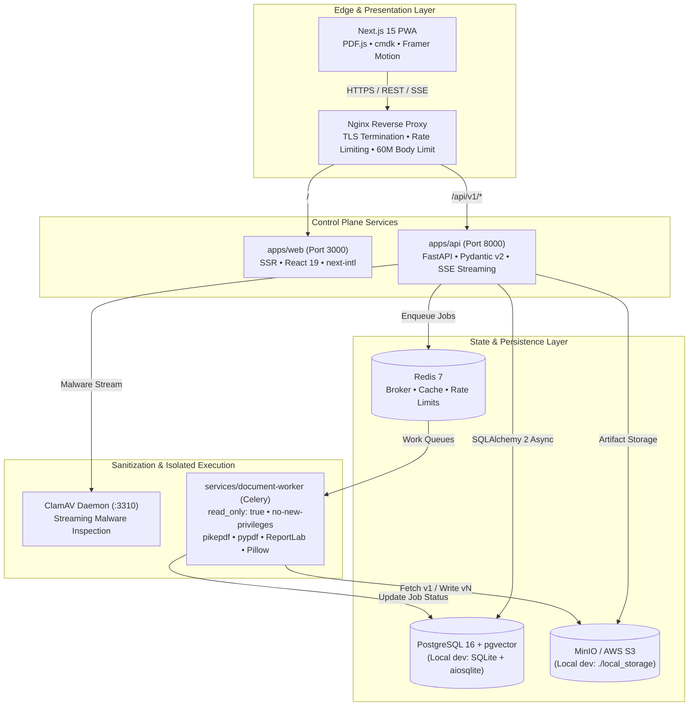

<div align="center">

# DocuMind AI

### High-Fidelity, Privacy-First Document Intelligence and Non-Destructive PDF Workspace

[](LICENSE)
[-10B981?style=flat-square&logo=githubactions&logoColor=white)](https://github.com/nanthishvaran17/DocuMind-AI/actions)
[-0F172A?style=flat-square&logo=nextdotjs&logoColor=white)](apps/web/package.json)
[](apps/api/pyproject.toml)
[](apps/api/requirements.txt)
[](docker-compose.yml)
[](docker-compose.yml)
[](apps/web/src/lib/i18n.ts)

<br />

An enterprise-grade document engineering platform combining deterministic PDF transformations, format conversions, OCR, vector semantic search (RAG), and human-in-the-loop multi-step autonomous agent workflows.

[Executive Overview](#executive-overview) | [Core Capabilities](#core-capabilities) | [System Architecture](#system-architecture) | [Quick Start](#quick-start) | [API & Data Schema](#api--data-schema) | [Security & Defense-in-Depth](#security--defense-in-depth) | [License](#license)

</div>

---

## Executive Overview

Online document utilities frequently suffer from opaque security practices: silent file overwrites, unverified lossy compression, arbitrary file retention, and undocumented tracking. 

**DocuMind AI** is engineered as a secure, observable, and non-destructive alternative built around four core architectural commitments:

- **Strict Non-Destructive Versioning:** Original files remain strictly immutable as `v1` with cryptographic SHA-256 verification. Every transformation (compression, rotation, watermark, extraction) produces an auditable `v2`, `v3`, or `vN` derivative.
- **Zero-Signup Ephemeral Guest Mode:** Users can process sensitive files immediately within isolated 60-minute guest environments (`POST /api/v1/auth/guest`). All files and derived artifacts are automatically cryptographically purged on expiration or on demand.
- **Deterministic Compression & Quality Auditing:** Target size algorithms (e.g., `< 100 KB`, `< 200 KB`) evaluate output artifacts using character similarity, structure retention, and visual metrics (SSIM).
- **License Hygiene & Execution Isolation:** High-risk parsing engines and AGPL-licensed tooling are strictly sequestered inside isolated, read-only worker containers behind permissive API boundaries ([ADR-001](docs/decisions/ADR-001-pymupdf-isolation.md)).

> [!IMPORTANT]
> **Data Privacy Guarantee:** Customer documents are strictly tenant-isolated via cryptographic session keys or verified account credentials. Files processed through DocuMind AI are never stored in third-party training corpuses.

---

## Core Capabilities

### 1. Document Studio & Workspace
- **Interactive Split-Pane Reader:** Embedded PDF.js reader with thumbnail ribbons, page metadata inspections, zoom, and real-time version history timeline.
- **Theme-Native Collapsible Shell:** Adaptive sidebar supporting expanded desktop navigation, icon-rail mode (`72px`, `Ctrl + \`), and dark/light modes.
- **Global Command Palette:** Instant keyboard-driven command navigation via `Ctrl + K` (`cmdk`) with localized command suggestions.
- **Vault Organization:** Hierarchical folder trees, starred favorites, quarantine Trash, and cryptographic shredding.
- **Bilingual Interface:** Native English and Tamil (`Noto Sans Tamil`) localization with seamless live switching.

### 2. Format Conversions & Zero-Loss Spreadsheets
- **PDF to Excel (`.xlsx`):** Extracts bordered and whitespace-aligned tables into dedicated worksheets while generating a primary unified `Combined_Data` sheet containing the document in sequential order.
- **Bidirectional Office Transforms:** Native round-tripping for DOCX, XLSX, PPTX, TXT, Markdown, and PDF.
- **Automated Quality Reports:** Generates post-conversion structural audits verifying character fidelity, table counts, and formatting preservation.

### 3. Student & Exam Utilities
- **Exact-KB Compression Engine:** Recompresses content to strict government and university upload thresholds (`100 KB`, `200 KB`, `1 MB`, `2 MB`).
- **Exam Photo & Signature Normalizer:** 1-click DPI and dimension compliance presets for UPSC, GATE, JEE, TNPSC, Passport, and PAN card portals.
- **Mobile Camera Scan:** Uploads and normalizes multi-page camera captures into clean, aligned PDFs.

### 4. AI Intelligence & Autonomous Workflows
- **Citations-Backed RAG:** High-speed semantic search over local document chunks powered by `pgvector` or lightweight local embeddings with page-level citations.
- **Approval-Gated Agent Workflows:** Deterministic agent planner that decomposes natural language tasks (e.g., *"Convert syllabus to PDF, merge with lab manual, and compress under 200KB"*) into reviewable steps requiring human approval before dispatch.

---

## System Architecture

DocuMind AI enforces a clean separation of concerns across its edge proxy, frontend client, control-plane API, background workers, and persistent data engines:



---

## Monorepo Layout

```text
DocuMind AI/
├── apps/
│   ├── api/                        # FastAPI control plane, SQLAlchemy models, Alembic migrations
│   │   ├── alembic/                # Database migrations
│   │   └── app/
│   │       ├── api/v1/             # Endpoints: auth, documents, tools, jobs, search, agent
│   │       ├── core/               # Configuration, Argon2id security, rate limits, logging
│   │       ├── db/                 # Async SQLAlchemy 2 models and session manager
│   │       ├── schemas/            # Pydantic v2 request/response and ProblemDetails contracts
│   │       └── services/           # Storage, ClamAV, file validation, job runners, RAG, agent planner
│   └── web/                        # Next.js 15 App Router frontend (PWA, bilingual EN/Tamil)
│       ├── messages/               # Localization strings (en.json, ta.json)
│       └── src/
│           ├── app/                # App Router routes and layouts
│           ├── components/         # AppShell, CommandPalette, Stageshow showcases, UI kit
│           ├── lib/                # API client, i18n, utilities
│           └── stores/             # Zustand state management (auth, preferences)
├── services/
│   └── document-worker/            # Isolated Celery conversion worker and PDF engines
├── packages/
│   ├── shared/                     # Presets, upload extensions, formatting utilities
│   ├── types/                      # Universal TypeScript domain and API contracts
│   └── ui/                         # Design system tokens and primitive styles
├── infrastructure/
│   ├── deployment/                 # Nginx production configuration
│   └── docker/                     # Optimized container specifications
├── tests/
│   ├── golden/                     # Golden master integration and quality verification tests
│   ├── integration/                # End-to-end API lifecycle and authentication tests
│   └── unit/                       # Component-level unit suites
├── .github/workflows/ci.yml        # Continuous integration pipeline
├── docker-compose.yml              # Multi-container orchestration specification
└── Makefile                        # Standardized automation commands
```

---

## Quick Start

### Method 1: Docker Compose (Production Environment)

To provision the full enterprise stack including PostgreSQL (`pgvector`), Redis, MinIO, ClamAV, FastAPI backend, isolated Celery worker, and Next.js frontend:

```bash
# 1. Clone repository and initialize environment variables
git clone https://github.com/nanthishvaran17/DocuMind-AI.git
cd DocuMind-AI
cp .env.example .env

# 2. Build and start services
docker compose up --build -d
```

| Service | Access Endpoint | Credentials / Purpose |
| :--- | :--- | :--- |
| **Web Application** | `http://localhost:3000` | Full Document Studio & PWA |
| **API Explorer** | `http://localhost:8000/api/v1/docs` | OpenAPI 3.1 Swagger Interface |
| **Health Check** | `http://localhost:8000/api/v1/health` | Service diagnostic telemetry |
| **MinIO Console** | `http://localhost:9001` | `minioadmin` / `minioadmin` |

---

### Method 2: Zero-Docker Local Development

The platform includes built-in fallbacks for zero-dependency local engineering using **SQLite** (`aiosqlite`), **local filesystem storage** (`./local_storage`), and an **in-process async task runner** (`TASK_RUNNER=inline`).

#### 1. Setup Environment
```bash
cp .env.example .env
```

#### 2. Start Backend API
```bash
# Setup virtual environment
python -m venv .venv

# Activate environment (Windows PowerShell)
.\.venv\Scripts\Activate.ps1
# Activate environment (macOS / Linux)
# source .venv/bin/activate

pip install -r apps/api/requirements.txt
cd apps/api
uvicorn app.main:app --reload --port 8000
```

#### 3. Start Frontend Web Client
```bash
# Install dependencies across the monorepo
pnpm install

# Start development server
pnpm --filter @documind/web dev
```

Open `http://localhost:3000` to access the Document Studio. SQLite schemas and default configurations initialize automatically on boot.

---

## API & Data Schema

All API endpoints follow standardized JSON envelope serialization:

```json
{
  "data": {},
  "error": null,
  "meta": {
    "request_id": "req_01h8v4kx9e7a8p...",
    "timestamp": "2026-11-11T21:00:00Z"
  }
}
```

HTTP error responses adhere strictly to **RFC 7807 Problem Details**:

```json
{
  "type": "https://documind.ai/errors/validation-error",
  "title": "Unprocessable Entity",
  "status": 422,
  "detail": "Uploaded file exceeds maximum allowable page limit.",
  "instance": "/api/v1/tools/compress-to-size"
}
```

### Core API Surface (`/api/v1`)

| Module | Route | Methods | Function |
| :--- | :--- | :--- | :--- |
| **Auth** | `/auth/guest` | `POST` | Spawn isolated 60-min guest token and vault |
| | `/auth/register` | `POST` | Account creation with Argon2id password hashing |
| | `/auth/login` | `POST` | Issue JWT access token and rotating refresh cookie |
| **Documents** | `/documents/upload` | `POST` | Single-shot upload with ClamAV and SHA-256 validation |
| | `/documents/upload/init` | `POST` | Initialize chunked, resumable large-file upload |
| | `/documents/{id}` | `GET, DELETE` | Retrieve document metadata or soft-delete to Trash |
| | `/documents/{id}/history`| `GET` | Audit log of all immutable versions (`v1..vN`) |
| **Tools** | `/tools/convert` | `POST` | High-fidelity format conversion (DOCX, XLSX, PPTX, PDF) |
| | `/tools/ocr` | `POST` | Multilingual text recognition (English + தமிழ்) |
| | `/tools/compress-to-size`| `POST` | Exact-KB target size reduction |
| | `/tools/pdf/merge` | `POST` | Multi-file merge with custom page range slicing |
| | `/tools/pdf/protect` | `POST` | AES-256 encryption with password protection |
| **Jobs (SSE)**| `/jobs/{id}/events` | `GET` | Live Server-Sent Events (SSE) status stream |
| **Intelligence**| `/ai/rag/search` | `POST` | Vector semantic search over document chunks |
| | `/ai/agent/command` | `POST` | Generate execution plan for human review |
| | `/ai/agent/runs/{id}/approve` | `POST` | Execute approved plan steps |

---

## Security & Defense-in-Depth

| Security Domain | Control Implementation |
| :--- | :--- |
| **Authentication** | `Argon2id` password hashing (`time_cost=2`, `memory_cost=65536`), short-lived access JWTs, HTTP-only refresh cookies, and CSRF token verification. |
| **Input Validation** | Magic-byte file header verification (`%PDF-`, `PK\x03\x04`), 40 MP image decompression-bomb protection, and 150 MB ZIP-bomb limits. |
| **Malware Quarantine** | ClamAV (`clamd`) stream scanning on upload; automatic extraction and stripping of executable JavaScript streams in PDF structures. |
| **Worker Containment** | Document workers run under non-root permissions, read-only root filesystems (`read_only: true`), and bounded temporary swap (`tmpfs`). |
| **Transport Security** | Strict Content-Security-Policy (CSP), `X-Frame-Options: SAMEORIGIN`, `X-Content-Type-Options: nosniff`, and production HSTS. |
| **License Quarantine** | AGPL-3.0 libraries (`PyMuPDF`) are strictly isolated inside worker microservices behind permissive fallbacks ([ADR-001](docs/decisions/ADR-001-pymupdf-isolation.md)). |

---

## Verification & Testing Standards

Every pull request and commit to `main` must pass the automated CI matrix:

```bash
# 1. Static typing and lint checks
ruff check --config apps/api/pyproject.toml apps/api services/document-worker tests
mypy --config-file apps/api/pyproject.toml apps/api/app services/document-worker/worker

# 2. Automated test suite with strict coverage enforcement
cd apps/api
pytest -v --cov=app --cov=../../services/document-worker/worker --cov-fail-under=80

# 3. Frontend package validation
cd ../../apps/web
pnpm lint
pnpm typecheck
pnpm build
```

---

## License

This project is licensed under the **[Apache License 2.0](LICENSE)**.

Refer to [`NOTICE`](NOTICE) for third-party software attribution and details regarding engine modularity. Core transformations operate exclusively on permissive components (`pikepdf` MPL-2.0, `pypdf` BSD-3-Clause, `ReportLab` BSD, `Pillow` HPND).

<div align="center">

<br />

Crafted for privacy, security, and high-fidelity document engineering.

</div>
