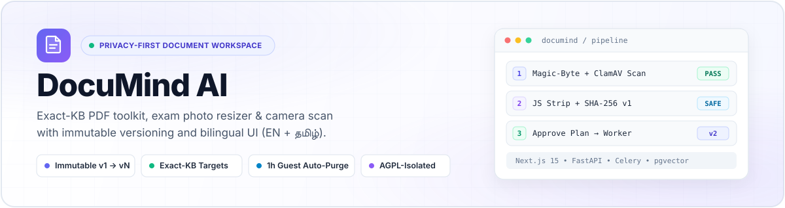
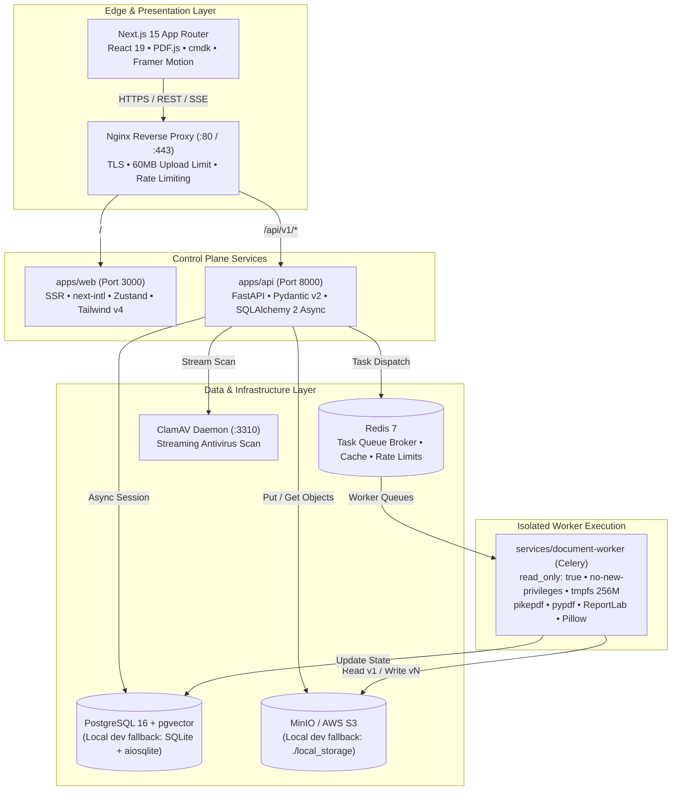
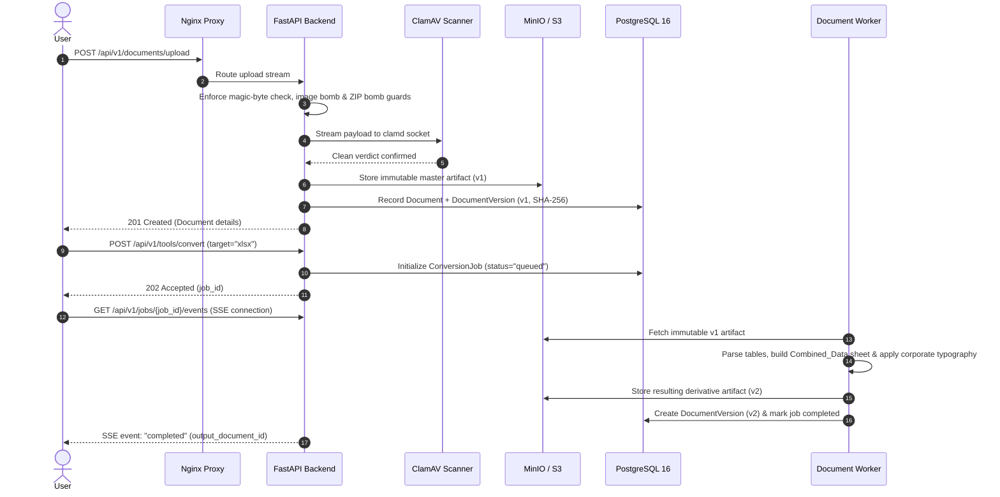

<div align="center">



<br />

[](LICENSE)
[-10B981?style=flat-square&logo=githubactions&logoColor=white)](https://github.com/nanthishvaran17/DocuMind-AI/actions)
[-0F172A?style=flat-square&logo=nextdotjs&logoColor=white)](apps/web/package.json)
[](apps/api/pyproject.toml)
[](apps/api/requirements.txt)
[](docker-compose.yml)
[](docker-compose.yml)
[](apps/web/src/lib/i18n.ts)

<br />

**DocuMind AI** is an enterprise-grade document engineering platform combining deterministic PDF transformations, lossless spreadsheet generation, multilingual OCR, vector semantic retrieval (RAG), and human-in-the-loop autonomous agent workflows.

[Overview](#overview) • [Feature Matrix](#core-capabilities) • [Comparison](#why-documind-ai) • [Architecture](#system-architecture) • [Quick Start](#quick-start) • [API Surface](#api-surface) • [Security](#security--defense-in-depth) • [License](#license)

</div>

---

## Overview

Most online document utilities treat file processing as a black box: they silently overwrite uploaded documents, retain sensitive student and business records on untrusted servers, fake compression ratios, and provide no guarantees against malicious script execution.

**DocuMind AI** is designed from first principles as an open-source, observable, and cryptographically secure document workspace:

- **Non-Destructive Version Immutability:** Uploaded files are stored as immutable `v1` artifacts protected by SHA-256 checksums. Any modification—whether compression, watermarking, page reordering, or extraction—produces an auditable `v2`, `v3`, or `vN` derivative while preserving the original.
- **Zero-Signup Ephemeral Guest Mode:** Users can process sensitive files immediately within isolated 60-minute guest sessions (`POST /api/v1/auth/guest`). All files, jobs, and vector embeddings are cryptographically shredded upon expiration or on user command.
- **Lead Analyst-Grade Conversions:** PDF to Excel extraction creates a unified `Combined_Data` worksheet containing all table rows and text in reading sequence, styled with executive Times New Roman typography, auto-filters, smart column alignments, and accounting double-underlines.
- **Human-In-The-Loop Autonomous Planner:** Complex, multi-stage requests (such as *"Convert syllabus to PDF, merge with lab manual, and compress under 200 KB"*) are decomposed into an inspectable step plan requiring explicit user confirmation before executing.
- **Rigorous License & Container Isolation:** Complex parsing libraries and AGPL-licensed dependencies are segregated inside a sandboxed, read-only worker microservice (`services/document-worker`) with non-root permissions and temporary memory-only scratch spaces ([ADR-001](docs/decisions/ADR-001-pymupdf-isolation.md)).

---

## Why DocuMind AI?

| Evaluation Dimension | Traditional Web PDF Converters | DocuMind AI Platform |
| :--- | :--- | :--- |
| **File Mutation** | Destructive; overwrites or replaces source file | Immutable `v1` master with full version history (`v1..vN`) |
| **Guest Privacy** | Files remain on third-party cloud disks indefinitely | 60-minute hard TTL with automatic cryptographic purge |
| **Data Extraction** | Partial table fragments scattered across disconnected sheets | Primary unified `Combined_Data` sheet with sequential reading order |
| **Compression Metrics** | Arbitrary quality sliders without target guarantees | Exact-KB target matching (`100 KB`, `200 KB`, `1 MB`, `2 MB`) |
| **Security Architecture** | Opaque processing prone to decompression bombs | 40 MP image bomb limits, 150 MB ZIP guards, ClamAV, and JS stripping |
| **AI Data Scrape** | User text frequently fed into public model training | Tenant-isolated vector store (`pgvector`); zero AI training usage |
| **Internationalization** | English-only interfaces | Native bilingual localization (English + தமிழ் with `Noto Sans Tamil`) |
| **Licensing Integrity** | Opaque commercial terms | Transparent Apache 2.0 core with isolated AGPL-3.0 worker boundaries |

---

## Core Capabilities

<table>
<tr>
<td width="50%" valign="top">

### Document Studio & Workspace
- **Interactive Split-Pane Reader:** Resizable viewer powered by PDF.js with thumbnail ribbons, page rotation, zoom controls, and metadata inspection.
- **Adaptive Shell & Navigation:** Responsive sidebar featuring an expanded view and an icon-only rail (`72px`, toggled via button or `Ctrl + \`).
- **Global Command Palette:** Instant keyboard-driven navigation (`Ctrl + K`) powered by `cmdk` with section grouping and fuzzy search.
- **Vault Organization:** Hierarchical folder trees, starred favorites, quarantine Trash, and permanent shredding.
- **Bilingual Interface:** Instant live switching between English and Tamil (`Noto Sans Tamil`) localization.

</td>
<td width="50%" valign="top">

### Format Conversions & Spreadsheets
- **PDF to Excel (`.xlsx`):** Multi-table extraction paired with a primary unified `Combined_Data` sheet preserving sequential reading order.
- **Executive Typography:** Built-in Times New Roman formatting, auto-filter headers, zebra stripes, and accounting double-underlines on summary rows.
- **Bidirectional Office Engine:** Seamless round-trip conversions between DOCX, XLSX, PPTX, TXT, Markdown, and PDF.
- **Quality Verification Reports:** Automated structural auditing calculating character similarity, table retention, and SSIM visual fidelity.

</td>
</tr>
<tr>
<td width="50%" valign="top">

### Student & Exam Utilities
- **Exact-KB Compression:** Recompression engine meeting strict portal upload caps (`100 KB`, `200 KB`, `1 MB`, `2 MB`).
- **Photo & Signature Normalizer:** 1-click dimension and DPI compliance presets for UPSC, GATE, JEE, TNPSC, Passport, and PAN portals.
- **Camera Scan to PDF:** Multi-photo perspective correction and mobile image collation into clean, unified PDFs.
- **Multilingual OCR:** Text extraction and searchable PDF creation supporting English and Tamil.

</td>
<td width="50%" valign="top">

### AI Intelligence & Agent Workflows
- **Citation-Backed RAG:** Vector semantic search across document chunks with page-specific citation references.
- **Two-Phase Agent Planner:** Decomposes natural language queries into deterministic, inspectable tool steps.
- **Human Approval Gates:** Execution halts at plan generation, allowing users to review, reorder, or approve before changes run.
- **Live SSE Streaming:** Real-time job event updates delivered via Server-Sent Events with progress telemetry.

</td>
</tr>
</table>

### Standardized Exam Photo & Document Presets

All presets are maintained as type-safe contracts in `packages/shared/src/index.ts`:

| Preset ID | Category | Target Dimensions | Target DPI | File Size Threshold | Target Format |
| :--- | :--- | :---: | :---: | :---: | :---: |
| `passport_india` | Identity Document | `413 × 531 px` (3.5 × 4.5 cm) | `300 DPI` | `< 100 KB` | `JPEG` |
| `signature_standard` | Candidate Signature | `413 × 177 px` (3.5 × 1.5 cm) | `300 DPI` | `< 50 KB` | `JPEG` |
| `gate_photo` | Entrance Examination | `480 × 640 px` | `200 DPI` | `< 200 KB` | `JPEG` |
| `upsc_photo` | Civil Services Portal | `350 × 350 px` | `200 DPI` | `< 300 KB` | `JPEG` |
| `pan_photo` | Tax Identity Card | `213 × 213 px` | `300 DPI` | `< 50 KB` | `JPEG` |
| `100kb` | PDF Compression | Page stream recompression | Dynamic | `< 100 KB` | `PDF` |
| `200kb` | PDF Compression | Page stream recompression | Dynamic | `< 200 KB` | `PDF` |

---

## System Architecture

DocuMind AI is architected as a modular monorepo cleanly partitioning the public client, control-plane API, async job queue, and isolated worker runtime:



### Non-Destructive Versioning Sequence



---

## Monorepo Layout

```text
DocuMind AI/
├── apps/
│   ├── api/                        # FastAPI control plane, SQLAlchemy async models, Alembic migrations
│   │   ├── alembic/                # Database schema migrations
│   │   └── app/
│   │       ├── api/v1/             # Endpoints: auth, documents, tools, jobs, search, agent
│   │       ├── core/               # Configuration, Argon2id security, rate limits, JSON logging
│   │       ├── db/                 # Async SQLAlchemy 2 models and session manager
│   │       ├── schemas/            # Pydantic v2 envelopes and RFC 7807 ProblemDetails
│   │       └── services/           # Storage, ClamAV, file validation, job runners, RAG, agent planner
│   └── web/                        # Next.js 15 App Router frontend (PWA, bilingual EN/Tamil)
│       ├── messages/               # Localization dictionaries (en.json, ta.json)
│       └── src/
│           ├── app/                # App Router pages and layouts
│           ├── components/         # AppShell, CommandPalette, Stageshow showcases, UI kit
│           ├── lib/                # API client, i18n helper, utilities
│           └── stores/             # Zustand state management (auth, preferences)
├── services/
│   └── document-worker/            # Isolated Celery conversion worker and PDF engines
├── packages/
│   ├── shared/                     # Presets, upload extensions, formatting utilities
│   ├── types/                      # Universal TypeScript domain and API contracts
│   └── ui/                         # Design system tokens and primitive styles
├── infrastructure/
│   ├── deployment/                 # Nginx production configuration (nginx.conf)
│   └── docker/                     # Optimized container specifications
├── tests/
│   ├── golden/                     # Golden master integration and quality verification tests
│   ├── integration/                # End-to-end API lifecycle and authentication tests
│   └── unit/                       # Component-level unit suites
├── .github/workflows/ci.yml        # Continuous integration pipeline
├── docker-compose.yml              # Multi-container orchestration specification
└── Makefile                        # Standardized automation commands
```

---

## Quick Start

### Option 1: Docker Compose (Production Environment)

Provisions PostgreSQL 16 (`pgvector`), Redis 7, MinIO, ClamAV, FastAPI control plane, Celery worker sandbox, and Next.js frontend:

```bash
# 1. Clone repository and initialize configuration
git clone https://github.com/nanthishvaran17/DocuMind-AI.git
cd DocuMind-AI
cp .env.example .env

# 2. Build and launch services
docker compose up --build -d
```

| Service | Access URL | Credentials / Notes |
| :--- | :--- | :--- |
| **Web Application** | `http://localhost:3000` | Next.js 15 UI with PWA support |
| **API Explorer** | `http://localhost:8000/api/v1/docs` | OpenAPI 3.1 Interactive Swagger UI |
| **Service Health** | `http://localhost:8000/api/v1/health` | Subsystem diagnostic endpoint |
| **MinIO Console** | `http://localhost:9001` | Default: `minioadmin` / `minioadmin` |

---

### Option 2: Zero-Docker Local Development

The platform includes built-in fallbacks for zero-dependency local development using **SQLite** (`sqlite+aiosqlite`), **local filesystem storage** (`./local_storage`), and an **in-process task runner** (`TASK_RUNNER=inline`).

#### 1. Configure Environment
```bash
cp .env.example .env
```

#### 2. Start the Backend API
```bash
# Create and activate Python virtual environment
python -m venv .venv

# Windows (PowerShell):
.\.venv\Scripts\Activate.ps1
# macOS / Linux:
# source .venv/bin/activate

pip install -r apps/api/requirements.txt
cd apps/api
uvicorn app.main:app --reload --port 8000
```

#### 3. Start the Frontend Application
```bash
# Install dependencies across all workspace packages
pnpm install

# Start the web client development server
pnpm --filter @documind/web dev
```

Visit `http://localhost:3000`. SQLite tables, directories, and default settings initialize automatically on initial startup.

---

## API Surface

All control-plane endpoints are versioned under `/api/v1` and deliver standardized JSON envelopes:

```json
{
  "data": {
    "id": "doc_92f08a9c1e",
    "name": "Research_Report.pdf",
    "current_version": 1,
    "size_bytes": 482104,
    "is_immutable": true
  },
  "error": null,
  "meta": {
    "request_id": "req_01h8v4kx9e7a8p",
    "timestamp": "2026-11-11T21:00:00Z"
  }
}
```

Validation and HTTP errors conform to **RFC 7807 Problem Details**:

```json
{
  "type": "https://documind.ai/errors/validation-error",
  "title": "Unprocessable Entity",
  "status": 422,
  "detail": "Uploaded file exceeds maximum allowed size of 50 MB.",
  "instance": "/api/v1/documents/upload"
}
```

### Endpoint Reference

<details>
<summary><strong>View Full API Routing Table</strong></summary>

| Category | Endpoint | Method | Description |
| :--- | :--- | :---: | :--- |
| **System** | `/health` | `GET` | Health checks for database, cache, storage, and worker queues |
| | `/metrics` | `GET` | Prometheus-formatted operational metrics |
| **Auth** | `/auth/guest` | `POST` | Spawn ephemeral 60-minute guest session with automatic purge |
| | `/auth/register` | `POST` | Create persistent user account with Argon2id password hashing |
| | `/auth/login` | `POST` | Authenticate credentials and receive short-lived JWT access token |
| | `/auth/refresh` | `POST` | Rotate access token using secure HTTP-only refresh cookie |
| | `/auth/logout` | `POST` | Invalidate active session and clear authentication cookies |
| **Documents** | `/documents/upload` | `POST` | Single-shot upload with ClamAV scan and SHA-256 fingerprinting |
| | `/documents/upload/init` | `POST` | Initiate chunked resumable upload for large documents |
| | `/documents/{id}` | `GET` | Retrieve document details and version history |
| | `/documents/{id}` | `DELETE` | Move document to quarantine Trash |
| | `/documents/{id}/restore` | `POST` | Restore document from Trash to active workspace |
| | `/documents/{id}/download`| `GET` | Download verified document artifact bytes |
| **Conversions** | `/tools/convert` | `POST` | Bidirectional conversions (PDF ↔ DOCX, XLSX, PPTX, TXT, MD) |
| | `/tools/ocr` | `POST` | Searchable PDF OCR extraction (English + தமிழ்) |
| | `/tools/compress-to-size`| `POST` | Target-size reduction (`100kb`, `200kb`, `1mb`, `2mb`) |
| **PDF Operations** | `/tools/pdf/merge` | `POST` | Multi-file merge with custom per-document page ranges |
| | `/tools/pdf/split` | `POST` | Page range extraction or chunked split |
| | `/tools/pdf/protect` | `POST` | AES-256 password encryption |
| | `/tools/pdf/unlock` | `POST` | Decrypt password-protected document |
| **Async Jobs** | `/jobs/{id}` | `GET` | Query background conversion status |
| | `/jobs/{id}/events` | `GET` | Real-time Server-Sent Events (SSE) progress stream |
| **Intelligence** | `/ai/rag/search` | `POST` | Vector similarity search with chunked citations |
| | `/ai/agent/command` | `POST` | Generate reviewable multi-step tool execution plan |
| | `/ai/agent/runs/{id}/approve` | `POST` | Authorize and dispatch approved agent plan |

</details>

---

## Security & Defense-in-Depth

| Security Domain | Mitigation Strategy & Implementation |
| :--- | :--- |
| **Authentication & Tokens** | `Argon2id` password hashing (`time_cost=2`, `memory_cost=65536`, `parallelism=2`), short-lived JWTs, rotating refresh cookies, and `X-CSRF-Token` headers. |
| **Input Validation** | Strict extension filtering, magic-byte header validation (`%PDF-`, `PK\x03\x04`), 40 MP image decompression-bomb protection, and 150 MB ZIP-bomb limits. |
| **Malware Quarantine** | In-flight ClamAV (`clamd`) stream scanning; automatic inspection and stripping of executable JavaScript structures from PDF streams. |
| **Worker Sandboxing** | Background workers run with `read_only: true`, non-root execution (`no-new-privileges:true`), and isolated `tmpfs` swap memory. |
| **Transport Hardening** | Strict Content-Security-Policy (CSP), `X-Frame-Options: SAMEORIGIN`, `X-Content-Type-Options: nosniff`, and production HSTS headers. |
| **License Quarantine** | AGPL-3.0 components (`PyMuPDF`) are strictly segregated inside worker microservices behind permissive fallbacks ([ADR-001](docs/decisions/ADR-001-pymupdf-isolation.md)). |

---

## Verification & Testing Standards

Every commit and pull request must satisfy the continuous integration suite in `.github/workflows/ci.yml`:

```bash
# 1. Static typing and lint validation
ruff check --config apps/api/pyproject.toml apps/api services/document-worker tests
mypy --config-file apps/api/pyproject.toml apps/api/app services/document-worker/worker

# 2. Automated test suite with mandatory 80%+ coverage threshold
cd apps/api
pytest -v --cov=app --cov=../../services/document-worker/worker --cov-fail-under=80

# 3. Frontend validation and production build
cd ../../apps/web
pnpm lint
pnpm typecheck
pnpm build
```

---

## License

This project is licensed under the **[Apache License 2.0](LICENSE)**.

Refer to [`NOTICE`](NOTICE) for third-party software attribution and details regarding engine modularity. Core transformations operate exclusively on permissive components (`pikepdf` MPL-2.0, `pypdf` BSD-3-Clause, `ReportLab` BSD, `Pillow` HPND).

<div align="center">

<br />

Crafted for privacy, security, and high-fidelity document engineering.

</div>
